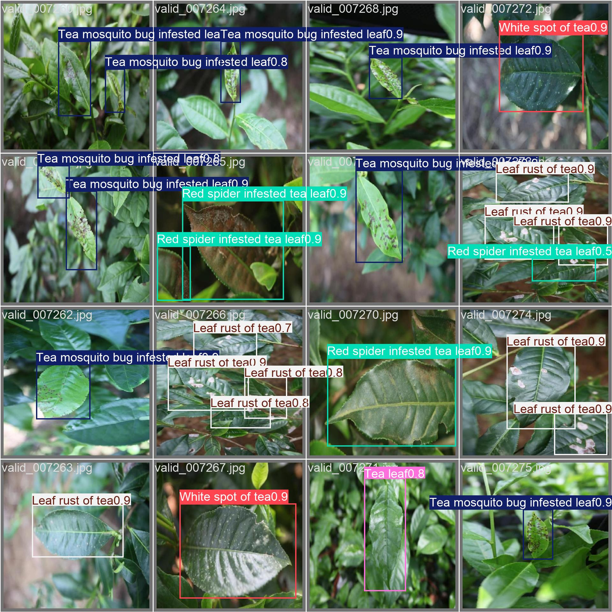
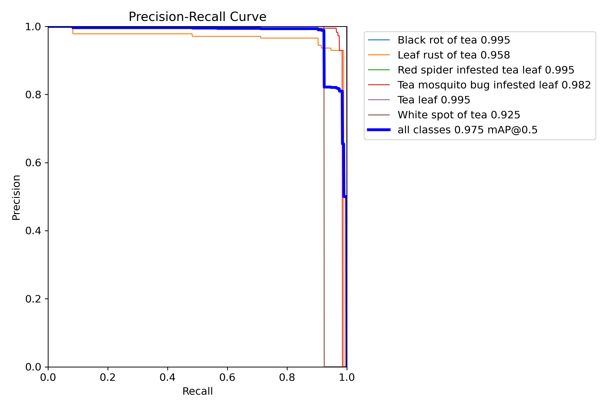
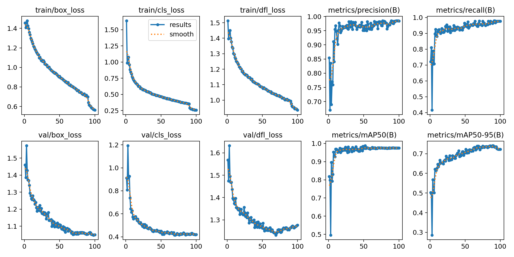

# 茶叶病虫害检测（YOLOv8n）

基于 YOLOv8n 的茶树病害/虫害目标检测项目，最终目标是**部署到硬件设备，用于茶园病虫害识别**。输入一张茶叶照片，模型用矩形框标出病/虫危害区域，并给出类别和置信度。目前已在电脑端（GPU）跑通完整链路：**环境配置 → 训练 → 推理 → 导出部署格式**。

## 识别效果（tea 数据集验证集）

| 指标 | 数值 |
| --- | --- |
| 精确率 P | **0.985** |
| 召回率 R | **0.964** |
| mAP50 | **0.975** |
| mAP50-95 | **0.741** |
| 训练轮数 | 设定 100 轮，第 88 轮早停（patience=30） |
| 训练耗时 | 约 1.4 小时（NVIDIA RTX 4050 Laptop） |
| 单张推理 | 约 1.9 ms（GPU） |

> **验证集：784 张图、1,042 个标注目标**；mAP 为各类别平均，实际只统计了**有足够样本的 6 个类别**（原因见文末“类别说明”）。

- **数据集：9,591 张图，8 个类别** —— figshare《Tea-Leaf Disease and Pest Detection Dataset v1.0》的 HuggingFace 镜像（`Project-AgML/tea_leaf_disease_pest_detection`），**CC BY 4.0** 开源协议
- **模型：YOLOv8n** —— 约 **313 万参数**、**8.6 GFLOPs**、权重仅 **6 MB**，专为边缘部署优化的轻量检测模型

验证集检测效果示例（不同颜色框 = 不同类别，框上为类别名与置信度）：



各类别的精确率-召回率曲线：



## 目录结构

```
tea-pest-detection/
├── data/tea/                    # 数据集（YOLO 格式）
│   ├── data.yaml                # 类别与路径配置
│   ├── train/  (7260 张)        # images/ + labels/
│   ├── valid/  (784 张)
│   └── test/   (1547 张)
├── scripts/
│   ├── train.py                 # 训练入口
│   ├── predict.py               # 推理入口（图片/视频/摄像头/文件夹）
│   ├── export.py                # 导出部署格式
│   └── prepare_data.py          # 原始 parquet → YOLO 格式的转换脚本（留档）
├── weights/
│   ├── yolov8n.pt               # COCO 预训练权重（训练起点）
│   ├── yolo11n.pt               # 备用预训练权重
│   └── yolo26n.pt               # 离线 AMP 自检占位文件（勿删，见“常见问题”）
├── test_images/                 # 自己的待检测图片放这里
├── assets/                      # README 展示用图（检测示例、PR 曲线、训练曲线）
├── runs/detect/
│   ├── tea_yolov8n/             # 训练产出（best.pt、results.csv、曲线图）
│   └── predict/                 # 推理结果图（每次运行自动清空并重新编号）
└── README.md
```

## 环境安装

需要 Python 3.10+、NVIDIA 显卡（推荐），本机验证环境为 Python 3.13 + CUDA 12.8：

```powershell
pip install ultralytics
# prepare_data.py 另需：pip install pandas pyarrow pillow
```

首次训练会自动使用 CUDA；无 GPU 时把 `scripts/train.py` 中的 `"device": 0` 改为 `"device": "cpu"`。

> 注：数据集体积较大（约 674 MB），未纳入 Git 仓库。复现训练请从 HuggingFace 下载 `Project-AgML/tea_leaf_disease_pest_detection` 的 parquet 文件，放到项目根目录命名为 `_raw.parquet`，再运行 `python scripts/prepare_data.py` 生成 `data/tea/`（train 7260 / valid 784 / test 1547）。

## 使用方法

### 1. 检测自己的图片（最常用）

1. 把图片（jpg / jpeg / png / bmp / webp）放进 `test_images/`；
2. 运行：

```powershell
python scripts/predict.py
```

3. 结果（带框 + 类别 + 置信度）保存在 `runs/detect/predict/`，自动编号为 1.jpg、2.jpg……

其他用法：

```powershell
python scripts/predict.py 图片.jpg      # 单张图片
python scripts/predict.py 视频.mp4      # 视频
python scripts/predict.py 0             # 摄像头实时检测（弹窗）
python scripts/predict.py 某文件夹       # 批量处理指定文件夹
```

阈值调节（`scripts/predict.py`）：漏检多就把 `CONF = 0.25` 调低（如 0.15），误检多就调高（如 0.4）。

### 2. 训练

```powershell
python scripts/train.py
```

关键配置在 `scripts/train.py` 顶部的 CONFIG 中，可直接修改：

| 参数 | 值 | 含义 |
| --- | --- | --- |
| epochs | 100 | 最大训练轮数，配合早停通常不会跑满 |
| imgsz | 640 | 输入图片缩放为 640×640 |
| batch | 16 | 每批 16 张；显存不足改 8 或 -1（自动） |
| device | 0 | 使用第 0 块 GPU；无 GPU 改 "cpu" |
| workers | 8 | 数据加载进程数（Windows 下崩溃可降为 4/0） |
| optimizer | auto | 自动选择，本次为 MuSGD，lr=0.01、momentum=0.9、weight_decay=0.0005 |
| patience | 30 | 验证指标连续 30 轮无提升则早停 |
| close_mosaic | 10 | 最后 10 轮关闭 mosaic 增强，利于收敛 |
| warmup_epochs | 3 | 前 3 轮学习率预热 |
| AMP | 开启 | 自动混合精度，省显存、提速 |
| 数据增强 | Ultralytics 默认 | mosaic、HSV 色彩抖动、水平翻转、随机擦除等 |

本次训练第 88 轮早停，耗时约 1.4 小时（RTX 4050 Laptop）。训练过程的损失下降与 mAP 上升曲线（完整数据见 `runs/detect/tea_yolov8n/results.csv`）：



断点续训（进程中断后从最近一轮继续，不丢进度）：

```powershell
python -c "from ultralytics import YOLO; YOLO(r'runs/detect/tea_yolov8n/weights/last.pt').train(resume=True)"
```

### 3. 导出部署模型

```powershell
python scripts/export.py onnx       # 默认 onnx；可选格式见下
```

| 格式 | 目标硬件 |
|---|---|
| onnx | x86 CPU / 通用，OpenVINO 中间格式 |
| openvino | Intel CPU / 核显 |
| engine (TensorRT) | NVIDIA Jetson（需在设备本机导出） |
| ncnn | 树莓派、安卓 |
| rknn | 瑞芯微 RK3588 等 |
| tflite | 安卓 / Coral Edge TPU |

YOLOv8n 体积小（best.pt 约 6 MB），树莓派纯 CPU 可达数 FPS，配合 Coral USB / Hailo 加速棒或 RK3588 NPU 可达 20–30+ FPS。边缘部署建议配合 INT8 量化、imgsz 降到 320 进一步提速。

## 类别说明

| ID | 类别 | 训练实例数 | 验证集 mAP50 / mAP50-95 |
|---|---|---|---|
| 0 | Black rot of tea（黑腐病） | 92 | 0.995 / 0.746 |
| 1 | Brown blight of tea（褐色枯萎病） | **4** | 验证集无实例，未学会 |
| 2 | Leaf rust of tea（锈病） | 2749 | 0.958 / 0.705 |
| 3 | Red spider infested leaf（红蜘蛛危害叶） | 735 | 0.995 / 0.765 |
| 4 | Tea mosquito bug infested leaf（盲蝽危害叶） | 5501 | 0.982 / 0.641 |
| 5 | Tea leaf（健康叶） | 299 | 0.995 / 0.831 |
| 6 | White spot of tea（白星病） | 240 | 0.925 / 0.758 |
| 7 | disease（笼统的“病害”，标注时未细分具体病种） | **4** | 验证集无实例，未学会 |

> 注：`disease` 是数据集自带的类别名，表示标注人员只判断出“这是病叶”、但没有标明具体是哪一种病害，属于语义笼统的杂项标签，不是模型里的特殊概念。
>
> ⚠️ 类别 1、7 训练样本各只有 4 个，模型实际无法识别这两类（整体 mAP 只统计其余 6 类）。如需识别褐色枯萎症状，需补充该类照片并重新训练。
> 另外模型对“单片叶近景”效果最好；茂密树冠远景、与训练场景差异大的照片泛化会下降。

## 常见问题

- **启动时终端十几秒没输出**：正在加载 torch/CUDA 和权重，不是卡死；单张图推理只需几毫秒。
- **首次训练卡在下载 yolo26n.pt**：Ultralytics 的 AMP 自检需联网下载该文件。`weights/yolo26n.pt` 已用本地权重占位，离线环境下自检会自动跳过（amp=True），不影响训练；若出现 NaN loss 再在 CONFIG 中加 `"amp": False`。
- **显存不足（OOM）**：把 batch 改为 8 或 -1（自动）。
- **`cache: ram` 未生效**：内存不足时 Ultralytics 会自动改为磁盘读取，仅略慢，不影响结果。
